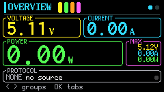
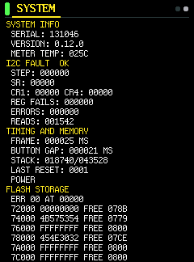

# kws-x1-standalone-rs

> **このブランチは `charging-logger`（実験logger版）です。** 画面キャプチャ版の基準と既存Releaseは `main` に残します。[ブランチ方針](docs/BRANCHES.ja.md)。loggerのビルドには `--features charging-logger` が必要です。

> **試作版・充電logger v0.4：** `--features charging-logger` でキャプチャ／BMP出力の代わりに、1秒間隔の電圧・電流保存、パッシブPD受信記録、USB経由のCSV出力を組み込みます。1台で約64秒のAVS掃引とPD区画またぎ、CY4500との共通区間516パケット一致を確認済みです。[日本語ガイド](docs/CHARGING-LOGGER.ja.md)／[英語ガイド（正本）](docs/CHARGING-LOGGER.md)／[検証記録](docs/LOGGER-VALIDATION.md)。通常ビルドは従来のキャプチャ版です。logger版のRelease配布ファイルはまだ公開していません。

[English README](README.md) · [Windowsでの2段階書き込み](docs/FLASHING.md#日本語)

KOWSI KWS-X1 USB-C 電力計向けの非公式Rustファームウェアです。このフォークは [kralonur版](https://github.com/kralonur/kws-x1-standalone-rs) をベースに、画面キャプチャの本体保存とUSB取り出しを追加しています。既存のUSBブートローダーを使ってアプリ部分を書き換えます。

## ダウンロードと書き込み

- [このフォークのReleases](https://github.com/inuchanbt/kws-x1-standalone-rs/releases) に、実機確認を終えた同じビルドの `firmware-upper.X1C`、`firmware.X1C`、`SHA256SUMS` が揃ったパッケージを掲載します。スクショのUSB取り出しには、条件付きで利用できるMSC用共用IDを使います。[USB識別子と利用条件](docs/USB-IDENTITY.md)
- Windows用の `flasher.exe` は [本家のflasherリリース](https://github.com/kralonur/kws-x1-standalone-rs/releases/tag/flasher-v0.1.2) から入手します。配布済みファイルの書き込みにRustやPythonは不要です。
- **Back＋OKを押しながら接続**して書き込みモードに入り、最初に `firmware-upper.X1C` を書き込みます。バックライトの短い2回点滅を確認したら、再度 **Back＋OKを押しながら差し直し**、`firmware.X1C` を書き込みます。ハッシュ照合、PowerShellコマンド、確認画面は [2段階書き込み手順](docs/FLASHING.md#日本語) を参照してください。

## 画面キャプチャ

1. 撮りたい画面で **左＋右を約0.5秒**押し、`CAPTURE SAVED` を待ちます。PD SESSION／PD SNIFF、CHARGER、CABLE、SYSTEMでは、**約2秒**長押しするとスクロール範囲を含む全行が縦長BMPになります。
2. USBを抜き、もう一方の端子を空けて、**左＋右だけ**を押しながら本体のUSB-Cメス端子をPCへつなぎます。Windowsのエクスプローラーで読み取り専用の `KWS X1` ドライブを開き、BMPをコピーします。
3. ボタンを押さずに差し直すと測定画面に戻ります。

ファイル名は `OVERVIEW09.BMP`、`CHARGER10.BMP` のように、メニュー名と全メニュー共通の撮影順です。メニュー情報のない旧スクショは `SCREEN` 名で表示します。日時はファイルの撮影順を示さないため、番号を使ってください。保存枚数は圧縮後のサイズと残り容量で変わります。

全行キャプチャの画像サイズは最低240×135ピクセルです。情報が少ない場合は下側に背景色の余白を補い、135ピクセルを超える場合は全行をそのまま保存します。余白はUSB取り出し時に生成するため、本体の保存容量は増えません。

実機から取り出した画像の例です。BMPからPNGへ、画素を変えずに変換しています。

| OVERVIEWの通常キャプチャ | SYSTEMの全行を保存した縦長キャプチャ |
| --- | --- |
|  |  |

キャプチャ後にVAWが停止する不具合の修正と、公開する2本の実機確認結果は [キャプチャの動作確認記録](docs/CAPTURE-VALIDATION.md#日本語) にまとめています。

`CAPTURE FULL - COPY/CLEAR` が出たら、残したいBMPをPCにコピーします。消去するには **左＋右＋Back** を押しながら **5VのUSB電源** を接続して起動し、`ERASE ALL CAPTURES?` が出たら全ボタンを離して **OKを2秒**押します。給電元はPCのほか、5Vで給電できるUSB充電器やモバイルバッテリーでも構いません。PC接続やデータ通信は不要です。**Back** でキャンセルできます。この操作はすべてのキャプチャを消去します。

## ビルドと互換性

このフォークのキャプチャ機能とUSB取り出しはKWS-X1実機で確認しています。ファームの全機能、他機種への互換性、給電時の注意点は [英語README](README.md) と [安全設計の説明](docs/SAFETY.md) を参照してください。

ソースからのビルドとX1Cの生成方法は [Build and validation](README.md#build-and-validation) にあります。標準のUSB識別子はMSC用の共用ID `16c0:27df` です。独自に利用権限のある番号を指定する場合は、4桁の16進数を `KWS_X1_USB_VID` と `KWS_X1_USB_PID` の両方に指定します。公開前には、その2本を実機に入れてUSB取り出しを確認します。

ライセンスは [MIT](LICENSE-MIT) または [Apache 2.0](LICENSE-APACHE) です。
