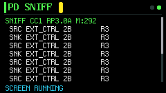
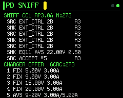

# Capture during EPR AVS traffic: Windows hardware validation

[Evidence and images](../tests/data/capture-pd-20261116/README.md) ·
[Offline replay / instrumented build](../tools/capture-autotest/README.md) ·
[Discussion #28](https://github.com/kralonur/kws-x1-standalone-rs/issues/28)

## Result and scope

On one KWS-X1, normal and full-page captures each saved eight images while an
ASD-PD31 generated EPR AVS traffic. All eight successful saving windows per mode
have supported overlap with negotiation. All 24 ordered Request/Accept/PS_RDY
signatures match CY4500 in every condition. No capture failures, trace overflow,
sniffer-stop markers, or flagged CY4500 PD errors/resets occurred in the selected
complete runs.

Within this setup, neither capture mode produced an observable negotiation
failure or a meaningful change in completion timing. This is one eight-transition
run per condition. It does not establish a general packet-loss or timing guarantee.

**KWS stayed in OFF/PASS passthrough; ASD-PD31 was the active sink.** This tests
capture during passive observation of real negotiations. KWS's own active trigger
or sink operation remains a separate hardware validation item.

## Setup

- Source/cable -> CY4500 -> KWS-X1 (OFF/PASS) -> ASD-PD31, 0.5 A load.
- Route: 20, 22, 24, 26, 28, 26, 24, 22, 20 V; eight voltage-change requests.
- ASD panel OBJ9 maps to native Object 11, EPR AVS. Holds were 3.0-4.4 seconds;
  each run's exact dwell pattern is included in its plan.
- Windows 11 build 26300, PowerShell 7.7.0, Rust/Cargo 1.99.1, Windows GNU x64.
- Firmware base: nieldk's `one-step-install` commit
  [`6201a9c`](https://github.com/nieldk/kws-x1-standalone-rs/commit/6201a9ce407e8bd72dba99e885612186d7b72fe6).
  The added `capture-autotest` feature timestamps PD/capture events and schedules
  captures after received Request/EPR_Request messages. Normal trigger and
  production screenshot/report paths are retained.
- All three conditions used the same instrumented image, SHA-256
  `bd38d5f2bd5ce738ac4ffa3f773812cf4ff7b1df2661a4ff77fc31ad29dab603`.

The earlier successful Windows install of the unmodified one-step branch was a
separate test, using image `dbb7e935...3eb21e9`. These measurements use the added
instrumentation and do not claim that image is byte-identical to the default build.

## Three-condition comparison

| Metric | BASE | SCREEN | TALL |
| --- | ---: | ---: | ---: |
| Complete voltage negotiations | 8 | 8 | 8 |
| Critical PD signatures matched to CY4500 | 24 | 24 | 24 |
| Captures saved / failed | 0 / 0 | 8 / 0 | 8 / 0 |
| Successful saves overlapping negotiation | N/A | 8 / 8 | 8 / 8 |
| Exported BMP dimensions | N/A | 240 x 135 | 240 x 192 |
| Request end -> PS_RDY start, median ms | 665.7565 | 665.7870 | 665.7755 |
| Same interval, range ms | 665.231-666.303 | 665.321-666.250 | 665.086-666.128 |
| Preparation marker interval, KWS ms | N/A | 0 at 1 ms resolution | 5-8 |
| Saving marker interval, KWS ms | N/A | 317-354 | 34-41 |
| Flagged CY4500 PD errors / reset messages | 0 / 0 | 0 / 0 | 0 / 0 |

The median differences from BASE are +0.0305 ms for SCREEN and +0.0190 ms for
TALL, smaller than variation within either run. Eight observations per condition
do not establish an equivalence bound. All nine ASD stages ended at approximately
0.500 A. Short current dips during downward transitions recovered before the
stable stage measurements.

| Normal screen | Full-page report |
| --- | --- |
|  |  |

All sixteen BMPs were opened and inspected. TALL includes CHARGER OFFER rows
outside the LCD viewport. PNG previews preserve every decoded BMP pixel; the
original BMPs are included too. The tested full-page height was 192 pixels.

TALL stores a small header snapshot plus printable text rows, while SCREEN uses
the raster screenshot encoder. A taller exported image can therefore require
less flash work, as observed here.

## Timing method and limits

The same millisecond boot clock timestamps accepted PD packets and capture
request, preparation and save boundaries. A bounded RAM trace avoids additional
trace flash writes during observation. The trace is committed after observation
ends, outside the measured interval. GoodCRC and routine EPR keepalive messages
are counted rather than individually logged; other messages retain the header
and first two objects. Truncated, overflowed, interrupted or ambiguous evidence
cannot pass the normal checks.

CY4500 and KWS clocks are aligned with eight matching requests using an affine
fit. Maximum request residuals are 2.118 ms for SCREEN and 1.227 ms for TALL.
Overlap requires margin against a 20 ms plus fit-residual guard. This is not
independent hardware synchronization, and negotiation-window overlap does not
isolate every on-wire packet or interrupt-disabled flash operation.

Preparation includes rendering/staging. Saving includes waits, compression or
report transfer, journal scanning, flash programming and yields. A zero-ms marker
interval reflects the available resolution, not zero CPU work.

Much longer reports, other sources/cables/loads, KWS active sink operation, and
Windows interrupted-update/power-loss/downgrade recovery remain outside this
measurement result. The default one-step updater and upstream adoption decisions
are separate from this experimental feature and evidence branch.

## Storage conditioning and provenance

Earlier pilots hit capacity limits because three of six capture sectors held
old XLG2/XLE2 logger data. Ordinary screenshot clear preserved that different
ownership type. With another sector reserved for the trace, only 16 KiB remained
for screenshots. A three-blank-sector readiness check proved insufficient.

The old data was backed up, its three full-sector SHA-256 fingerprints checked
on-device before any erase, and post-erase readback confirmed all other capture
bytes unchanged. The exact original test firmware was restored. The final runs
used the reclaimed capture pool; the trace reserves 8 KiB, leaving 40 KiB for
images. The current readiness check requires all six sectors blank. This device
history does not justify erasing unfamiliar data on another meter.

The published complete runs are:

- BASE: `kws_avs_uqry5xx1`.
- SCREEN: `kws_avs_d2euwgp4`.
- TALL: `kws_avs__azwvlpx`.

Each has raw CY4500/ASD CSVs, the dwell plan, committed trace bytes, decoded CSV
and comparison JSON. The BASE distribution keeps its trace sector verbatim at
the original offset and fills unrelated sectors with 0xff; SCREEN/TALL retain
their entire 48 KiB exports. Original/distributed hashes and this derivation are
explicit in [PROVENANCE.json](../tests/data/capture-pd-20261116/PROVENANCE.json).
Data checksums and an offline replay command make the comparison reviewable
without a meter or the separate hardware-controller software.

## 日本語補足

BASE・通常画面・縦長の3条件を比較した。通常と縦長は各8枚の保存に成功し、
すべて保存処理がネゴ中に重なった。主要24メッセージは各条件でCY4500と一致した。
今回の条件では通信エラーやネゴ時間の悪化は見られなかった。
KWSはPASS/OFFでの受動観測であり、KWS自身のアクティブなトリガ動作中や、
192ピクセルより長い縦長画像は別の検証対象。再解析は機器なしで実行できる。
